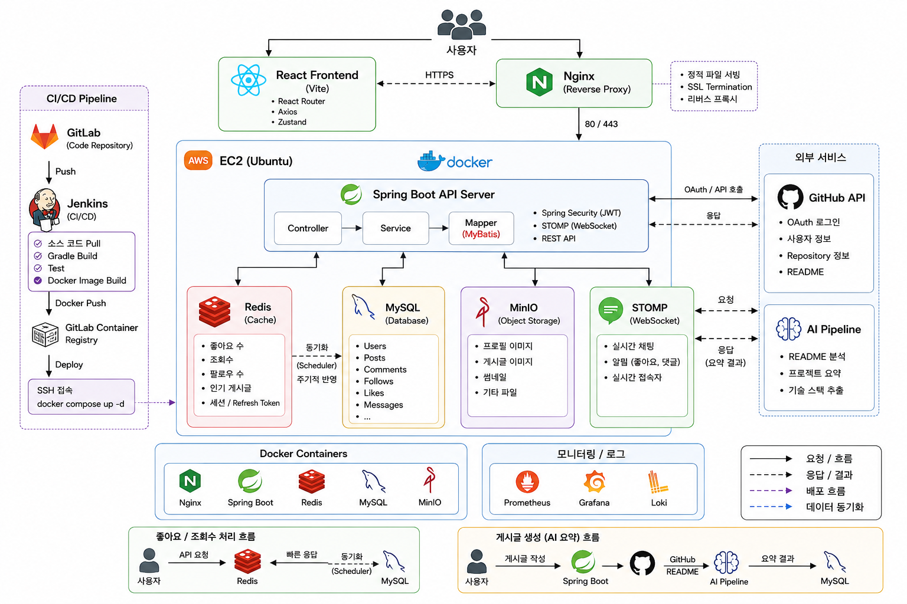

# Hello World

개발자를 위한 SNS **"Hello World"** — SSAFY 15기 공통 프로젝트 (Sub PJT 1, E204).

개발자들이 프로젝트·성장 기록을 공유하고, 서로 팔로우하며 소통하는 소셜 네트워크 서비스입니다.

---

## 레포지토리 구조

```
S15P11E204/
├── backend/                      # 백엔드 (Spring Boot 3 / Java 17)
│   ├── CLAUDE.md                 # 백엔드 개발 규칙 (필독)
│   ├── README.md                 # 백엔드 개발 가이드 · 실행 방법
│   ├── pom.xml
│   └── src/
├── frontend/                     # 프론트엔드 (React 19 / TypeScript / Vite)
│   ├── CLAUDE.md                 # 프론트엔드 개발 규칙 (필독)
│   ├── README.md                 # 프론트엔드 개발 가이드 · 실행 방법
│   └── src/
└── 공통 - Sub PJT 1 중간 평가/      # 팀 공통 문서
```

각 파트별 상세 실행 방법·규칙은 해당 폴더의 `README.md`를 참고하세요.

## 기술 스택

| 파트 | 스택 |
|------|------|
| Backend | Java 17 · Spring Boot 3 · Maven · MyBatis · MySQL · Redis · AWS SQS · JWT |
| Frontend | React 19 · TypeScript · Vite · TanStack Query · Zustand · axios · STOMP(WebSocket) |
| Infra | ALB · WAS · CDN / Vercel |

## 브랜치 전략

- `master` : 배포용 (protected, 직접 push 금지)
- `develop` : 통합 브랜치 — 모든 작업의 기준
- `feature/{도메인}` : 기능별 작업 브랜치 (`develop`에서 분기 → 완료 후 `develop`으로 MR)

```bash
git checkout develop
git pull
git checkout -b feature/{도메인}
# 작업 후
# develop 으로 Merge Request
```

## 개발 시작하기

- **백엔드**: [`backend/README.md`](backend/README.md)의 "개발 시작 전 필독" 순서를 따르세요.
- **프론트엔드**: [`frontend/README.md`](frontend/README.md)를 따르세요.
- 민감정보(DB 비밀번호, JWT secret, AWS 키)는 절대 커밋하지 않습니다. 로컬 설정 파일 / 환경변수로만 주입합니다.

## ERD


## 아키텍처



## 설계 문서

기능명세서 · ERD · API 명세서는 팀 Notion 워크스페이스에서 관리합니다.
